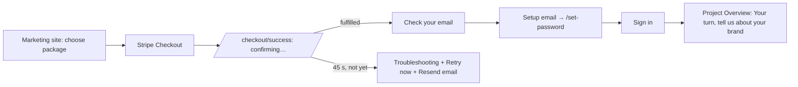

# UX design specification: Logo Fountain portal (Laravel)

**Author:** Mat (owner), drafted by Claude · **Date:** 2026-11-18

> **How to use this document.** It's the contract every screen is built to. If a screen needs something that isn't here, add it here first (with a reason), then build it. "It looked better" is not a reason. Each rule says *why*, so it can be applied to cases this document doesn't list.

---

## 1. Discovery: what the portal is for

**Logo Fountain's operation in one line:** a customer pays → tells us about their brand → the designer sends concepts → the customer gives feedback within a fixed allowance → the customer approves one → the designer delivers final files.

Everything in the portal exists to move a project one step along that line, or to show where it is on it. That gives the core organising idea of the whole design:

> **The project is the unit. The lifecycle is the spine. "Whose move is it?" is the first thing every screen answers.**

| Audience | Device reality | What they need from every visit |
|---|---|---|
| Customer (founder or SMB owner) | Mostly **phone**, often in short gaps; laptop for the brief | "Is anything waiting on me? If so, what, and how do I do it?" Then, occasionally: "Where are my files? Where's my invoice?" |
| Admin (single designer-operator) | **Desktop**, long sessions | "What needs me, in what order?" Then fast, mistake-proof actions: upload, reply, deliver, unblock |

Constraints carried over from the behaviour spec (these can't change): every feature in the inventory; identical rules, limits, prices and emails; polling (10 s customer hub, 2 s admin project, 2.5 s audit); the brief's 16 questions and their limits; all confirmations (brief submission, concept approval, clean-slate reset) stay as **explicit** confirmations.

## 2. Core user experience

### 2.1 The defining experience
**Customer:** open the portal → in one glance see *the one thing to do now* (or "nothing needed, your designer is on it, here's what happens next") → do it in as few taps as possible → get clear confirmation and a clear "what happens next".
**Admin:** open the queue → the most urgent item is at the top → one click into the project → the right action is the primary button → done → back to the queue.

### 2.2 The user's mental model
Customers don't think in states (`REVISIONS_IN_PROGRESS`). They think in **turns**: *my turn / their turn / done*. They think about allowances as **a small stock of something valuable** ("I have 2 revisions left"). The UI must speak in those terms. State names never appear to customers; plain-language stage names and next-step copy do (the existing `NEXT_STAGE_COPY` and journey copy are a good base).

### 2.3 Success criteria (measured before launch, see the product brief)
- 5-second test: "what do you need to do now?" answered correctly by **5 of 5** first-time customers.
- Revision request, approval and final download: **≤ 3 taps** from project overview on a phone.
- Admin: any needs-action item in **1 click** from the queue. Concept upload **< 60 s** without errors.
- Nothing destructive or money-spending happens without an explicit, specific confirmation.

### 2.4 Novel vs. established patterns
Use **established patterns only** (Jakob's law: people spend most of their time on other products). Tabs, lists, cards, a stepper, a chat thread, a file card, modal confirmations. The only "signature" element is the **stage tracker**, and even that is a conventional stepper.

### 2.5 Experience mechanics: the status model
Every project status maps to exactly one **turn**, which drives colour, iconography and copy everywhere:

| Turn | Statuses | Customer copy | Visual |
|---|---|---|---|
| **Your turn** | AWAITING_BRIEF, CONCEPTS_READY (and AWAITING_APPROVAL is *not* here), FINAL_FILES_READY | "Your turn: …" plus the single primary action | Accent (brand purple) filled pill and a primary button |
| **Designer's turn** | BRIEF_SUBMITTED, IN_DESIGN, REVISIONS_IN_PROGRESS, AWAITING_APPROVAL (shown as "Approved, final files being prepared") | "Nothing needed from you. Your designer is …" plus when to expect the next step | Neutral pill with a progress glyph |
| **Done** | DELIVERED | "Complete. Your files are always here." | Success pill |
| **Paused** | ON_HOLD | "Paused. Check messages." | Warning pill plus a link to messages |
| **Closed** | CANCELLED, REFUNDED | "Cancelled" / "Refunded" | Neutral, muted |

(The customer-action states follow `customerActionFor` in the current code: AWAITING_BRIEF, CONCEPTS_READY, FINAL_FILES_READY.) **Stage-specific colours from the current UI are dropped.** Eleven colours don't tell anyone anything; three meanings do.

## 3. Emotional response

Target feeling: **calm, confident, looked-after**: "a real designer is handling this, and I'm in control."
- **Calm:** generous whitespace, one primary action per view, no alarms unless something is genuinely blocked.
- **Confident:** limits and prices shown plainly *before* they matter, never as a surprise. Every action confirms what happened and what happens next.
- **Looked-after:** a personal tone ("your designer"), first names, celebration only at real high points (first concepts arrive, approval, final files), and never on routine actions.
- **Premium without fuss:** restraint over decoration. Quality shows in type, spacing and detail, not in gradients.

## 4. Inspiration (reference qualities, not things to copy)

| Reference | What to take |
|---|---|
| Linear | Admin density: list-and-detail with a properties column, keyboard-friendly, quiet chrome |
| Stripe Dashboard | Clarity of money and status; tables that stay readable |
| Basecamp / Height client views | "What's waiting on whom" made obvious to non-technical clients |
| Apple Health / banking apps | Phone-first status summaries; big readable numbers; bottom navigation |
| The Logo Fountain marketing site | The brand: ink, paper and parchment neutrals, brand purple `#5150F7`, Sfizia display serif, Inter, Geist Mono |

## 5. Information architecture

### 5.1 Customer
```
Sign in / set password / reset / magic-link confirm         (public, auth shell)
Checkout success · checkout continue                         (public, auth shell)
Projects                (home; one row per project; skipped when there's exactly one, see 5.3)
└── Project
    ├── Overview        turn banner, next action, stage tracker, allowances, recent activity
    ├── Concepts        gallery → Concept detail (image + version history, feedback thread, request revision, approve)
    ├── Messages        chat with your designer
    ├── Brief           wizard (before submission) / read-only brief (after)
    └── Files           final files (when ready) + this project's invoices/receipts
Account                 profile (name), password, theme, sign out
Invoices                every invoice/receipt across projects
```
- **Project sections are tabs** (desktop: a horizontal tab bar under the project header; phone: a **bottom tab bar**: Overview · Concepts · Messages · Files, with Brief reachable from Overview and the overflow). Thumb reach (Fitts) and recognition over recall: the four places a customer goes are always one tap away.
- "Files" is a new grouping. Today final download sits in the hub and invoices sit in settings. Customers look for *their stuff* in one place. Invoices also stay globally under Account → Invoices.
- Badges on tabs: **dot** for "new" on Concepts and Messages (the existing read-state rules), never a count of system events.

### 5.2 Admin
```
Queue                    Needs action · In progress · Done (urgency-sorted, existing score)
└── Project workspace
    ├── Overview        state + allowed actions, allowances & overrides, order/payment & reprocess, timeline
    ├── Concepts        feedback inbox (pending revisions first) · concepts grid · upload / replace / revision
    ├── Messages        project thread
    ├── Brief           rendered brief
    ├── Files           finals: upload / replace / notify retry / download
    └── Audit           event log (polling)
Health                   system checks
```
- Layout: a **left sidebar** (Queue, Health, account) plus a **list-and-detail** workspace with a **properties column** (status, client and contact, package, allowances, order, quick actions). The current direction in `apps/web/docs/design-system.md` is kept here because it suits dense operational work.
- Every project-level destructive or irreversible action (cancel, clean-slate reset, entitlement override, notify retry) lives in a clearly separated "Actions" area with confirmations. It's never next to routine buttons.

### 5.3 Navigation rules
1. **One project → straight to it.** A customer with exactly one project lands on that project's Overview when they sign in. The Projects list appears only with two or more projects (a route-level UX change, logged as part of DV-UX. The `/dashboard` URL keeps working and redirects).
2. Admins hitting customer URLs are redirected to the admin workspace for that project (as today: `/dashboard` → `/admin`).
3. **Breadcrumbs** on desktop (Projects › Brand name › Concepts › Concept 2). On phones, a back arrow with the parent's name.
4. Deep links from every email land on the exact section the email is about (the existing CTA paths).

## 6. Design system foundation

**Choice:** a custom, token-based design system built on **Tailwind 4** (CSS variables as tokens) with **accessible headless primitives** for complex widgets (dialog, menu, tabs, tooltip, popover). Recommended: **Radix UI primitives** (or React Aria; the choice is made in the architecture ADR). They give correct focus management, keyboard support and ARIA without imposing a look.

**Why not a ready-made kit (MUI or shadcn defaults):** the brand needs its own voice, and a kit's look is instantly recognisable as generic. **Why not hand-roll widgets:** dialogs, menus and tabs are where hand-rolled UI fails accessibility. Primitives for behaviour, our tokens for the look.

**Rules (enforced by the L7b lint):**
1. Colours come **only** from semantic tokens (§8.1). No raw hex, `gray-*`, `white` or `black` in components.
2. Type comes **only** from the scale (§8.2). No arbitrary sizes.
3. Spacing comes **only** from the 4 px scale (§8.3).
4. Radius, shadow and motion come **only** from their tokens.
5. Every component is built once in `resources/js/Components/ui/` and documented in a component catalogue page (`/dev/ui`, local only), showing every variant, both themes and every state.

## 7. Defining interactions (the moments that matter)

| Moment | Design |
|---|---|
| **Your turn: brief** | Overview shows the turn banner "Your turn: tell us about your brand (about 10 minutes)" plus a primary button. The wizard has 4 short sections plus review, autosaves ("Saved" with a time, or "Saved on this device" when offline), and the confirmation dialog keeps its checkbox and copy |
| **Concepts arrive** | A one-time celebration banner on Overview ("Your first concepts are here"). The Concepts tab shows a dot. The gallery shows big images, the concept number and the version |
| **Feedback and revision** | On concept detail, **one composer** with two clearly different outcomes. "Send a comment" (free, doesn't use an allowance). "Request a revision" (uses 1 of N), which shows **before** sending: "This uses 1 of your 2 revisions. You'll have 1 left." After sending, the allowance meter shows it as *in progress* (reserved), not yet *used* (consumed) |
| **Allowance exhausted** | The revision button changes to an explanation plus the two valid next steps: "Add a revision (£95)" and "Upgrade to Professional (£495)" where eligible (the existing rules). The "Not now" snooze keeps its 24 h |
| **Approval** | A primary "Approve this concept" on the concept detail. Confirmation dialog: what approval means (the other concepts are archived; final files are prepared), with the acknowledgement checkbox and the existing copy |
| **Final files** | The Overview turn banner: "Your final files are ready" plus "Download ZIP" (one tap). The Files tab keeps them forever, with the file name and date |
| **Purchase confirmation** | After an upsell or checkout: a persistent, polite status ("Confirming your purchase…" → "Purchase confirmed: you now have 3 revisions"). Never a spinner with no words |
| **Admin: act on the queue** | A row shows *why* it needs action (e.g. "2 revision requests · new message"). Clicking opens the project on the section that needs action |

## 8. Visual foundation

### 8.1 Colour tokens (semantic; contrast verified 2026-11-18, WCAG 2.x relative luminance)

Neutrals are warm, taken from the marketing site's ink, paper and parchment so the portal and the site feel like one brand. The accent is the brand purple **`#5150F7`, unchanged**.

| Token | Light | Dark | Use | Contrast (text tokens vs bg / surface / sunken) |
|---|---|---|---|---|
| `bg` | `#FBF9F4` | `#121211` | Page background | n/a |
| `surface` | `#FFFFFF` | `#1B1B19` | Cards, panels, inputs | n/a |
| `sunken` | `#F3EEE3` | `#0C0C0B` | Wells, table headers, code, properties column | n/a |
| `divider` | `#E7E1D5` | `#2A2926` | Decorative separators only (exempt) | n/a |
| `border` | `#857E6F` | `#77726A` | **Input and control boundaries** (needs ≥ 3:1) | L 3.83 / 4.03 / 3.48 · D 3.93 / 3.61 |
| `fg` | `#151412` | `#F2EFE8` | Primary text | L 17.5 / 18.4 / 15.9 · D 16.3 / 15.0 / 17.0 |
| `fg-2` | `#4A4740` | `#C2BDB2` | Secondary text | L 8.8 / 9.3 / 8.0 · D 10.0 / 9.2 / 10.5 |
| `fg-3` | `#6B675E` | `#9B968B` | Tertiary: timestamps, hints | L 5.4 / 5.6 / 4.9 · D 6.4 / 5.9 / 6.6 |
| `accent` | `#5150F7` | `#8E8DFF` | Primary buttons, focus, current step, "your turn" | L 5.5 vs white text · D 6.9 vs `#0C0C0B` text |
| `accent-fg` (text on accent) | `#FFFFFF` | `#0C0C0B` | Text on filled accent | (above) |
| `accent-text` | `#4241D6` | `#A3A2FF` | Links and accent text on surfaces | L 6.8 / 7.1 / 6.1 · D 8.2 / 7.5 / 8.6 |
| `accent-soft` | `#ECEBFF` | `#24234A` | Selected rows, the "your turn" banner background | accent-text on it: L 6.1 · D 6.5 |
| `success` / `success-soft` | `#17704A` / `#E6F4EC` | `#4CC38A` / `#12301F` | Done, confirmations | on soft: L 5.4 · D 6.5 |
| `warning` / `warning-soft` | `#8A5300` / `#FBF0DC` | `#E7A93B` / `#33270F` | Paused, attention | on soft: L 5.6 · D 7.1 |
| `danger` / `danger-soft` | `#B42318` / `#FDECEA` | `#F97066` / `#3A1714` | Errors, destructive actions | on soft: L 5.8 · D 5.7 |

Rules: every text and background pairing used must be one of the verified pairs above (≥ 4.5:1 for text, ≥ 3:1 for UI boundaries and large text). **Colour never carries meaning alone.** Status always has a text label, and errors have an icon plus text. Dark mode isn't an inverted light mode. Surfaces get *lighter* as they rise (bg → surface), and shadows are replaced by borders and tone.

**Theme:** System (default) / Light / Dark, chosen in Account and the user menu. It's stored in `localStorage` and applied before first paint (as today with `theme-init.js`), so there's no flash. The `prefers-color-scheme` media query is the default.

### 8.2 Typography
- **Sans: Inter** (variable, self-hosted) for all UI. **Mono: Geist Mono** for IDs, order references and file names.
- **Display: Sfizia** (brand serif; the owner confirmed on 2026-11-19 that the licence covers the app). It's for large titles only, for readability, and allowed in **exactly three places**, all customer-facing:
  1. the project name heading on the customer **Overview**;
  2. the headline on the **auth screens** (sign in, set or reset password);
  3. the headline of **celebration** turn banners (first concepts, approval, final files).

  Rules:
  - minimum **32 px desktop / 28 px phone**, regular weight only, at most **one** Sfizia line per screen;
  - **never** in the admin UI, section headings, buttons, labels, body copy, tables or email.
  - Sfizia is available **only** via the `DisplayTitle` component, and the design-system lint (L7b) fails any other use of the display font token.
  - It's preloaded only on the pages that use it, with `font-display: swap`.
- Fluid scale (Utopia, 1.2 ratio at 320 px → 1.25 at 1400 px, a 16 → 18 px base, as in the current design-system doc):

| Token | Step | Use |
|---|---|---|
| `text-xs` | −2 | Badges and pills only |
| `text-sm` | −1 | Labels, metadata, buttons, nav, breadcrumbs, hints |
| `text-base` | 0 | **Anything read as a sentence**: body, descriptions, errors, messages, brief answers |
| `text-lg` | 1 | Section titles |
| `text-xl` | 2 | Card headlines, the turn banner title |
| `text-2xl` | 3 | Page title (one per page), key numbers (allowances) with `tabular-nums` |
| `text-3xl`–`4xl` | 4–5 | Sfizia display moments only (the three places above, via `DisplayTitle`) |

- Line length 60–75 characters for reading text (`max-w-prose`). Line height 1.5 for body, 1.2 for headings. Weights: 400 body, 500 labels, 600 headings. Never below 16 px for input text (it stops iOS zoom).

### 8.3 Space, layout, shape, elevation, motion
- **Space:** a 4 px base. Tokens `1`=4, `2`=8, `3`=12, `4`=16, `5`=20, `6`=24, `8`=32, `10`=40, `12`=48, `16`=64. Related things are close; groups are separated by at least 2 steps more than their contents (Gestalt proximity).
- **Grid:** customer content max **960 px** centred (reading comfort). Admin workspace is fluid, with the properties column at **360 px**. Page gutters 16 px (phone), 24 px (tablet), 32–40 px (desktop).
- **Radius:** `sm` 6 px (inputs, pills), `md` 10 px (buttons, cards), `lg` 16 px (sheets, dialogs, image cards). One radius per component type.
- **Elevation:** light uses 2 shadows only (`raised`: cards on hover and menus; `overlay`: dialogs and sheets). Dark uses borders and tone, no shadows.
- **Motion:** 150 ms (micro) / 250 ms (panels), ease-out. Only to explain change (a tab indicator, a sheet entering, a progress fill). `prefers-reduced-motion` turns all of it off. No parallax, no looping animation.
- **Icons:** Lucide (outline, 1.5 px stroke, 16 / 20 px), always with a visible label or an `aria-label`.

## 9. Design direction: **A, Studio paper (chosen by the owner, 2026-11-18)**

Three directions apply the same IA, tokens structure and components but differ in character. A comparison page with light and dark is in [`ux/design-directions.html`](ux/design-directions.html).

| Direction | Character | Neutrals | Display type | Best for |
|---|---|---|---|---|
| **A: Studio paper** *(recommended)* | Warm, editorial, premium. Feels like the marketing site's portal | Paper, parchment, ink (§8.1 as written) | Sfizia for page headlines | Brand continuity from site to portal, a "designer-led" feel |
| **B: Clean ink** | Crisp, contemporary SaaS. Cool white and near-black | Cool greys (`#FFFFFF` / `#F6F7F9` / `#0B0C0E`) | Inter only | Maximum "modern tool" feel, less brand warmth |
| **C: Soft contrast** | Friendlier: tinted purple surfaces, rounder shapes, larger type | Purple-tinted neutrals | Sfizia italic accents | A more consumer feel, at a risk of reading less premium |

**Recommendation: A.** It's the only one that makes the portal feel like the same company as the marketing site the customer just bought from (Jakob's law in brand form: no "where am I?" moment after checkout). The warmth reads premium and designer-led rather than generic SaaS, and it stays modern through strict restraint: flat surfaces, sharp type, generous space, one accent. The current design-system doc's direction (Linear layout plus warm neutrals plus brand purple) is essentially A. This spec makes it consistent.

## 10. User journey flows

### J1: Purchase → first visit (customer)

Design notes: the success page says what's happening in words at every moment. The set-password page shows the password rules **before** typing (8+ characters, max 72 bytes in plain terms: "up to 72 characters"). After the password is set → sign in with the email prefilled.

### J2: Brief (customer)
Overview (your turn) → wizard section 1/4 → … → review (every answer, editable inline) → confirmation dialog → Overview (designer's turn: "Your designer is reviewing your brief").
Rules: progress visible ("Step 2 of 4 · Audience & goals"). Required fields marked "Required" in text (not just an asterisk). Errors inline, under the field, in `text-base` and `danger`, plus a summary at the top of the step on submit, with links to each field. Never lose input: the autosave states are always visible.

### J3: Concepts → feedback → revision → approval (customer)
Overview (your turn: "Your concepts are ready") → Concepts gallery → Concept detail → either **Comment** (free), **Request revision** (allowance preview, then confirmation in place), or **Approve** (dialog). Back on Overview the turn changes and the stage tracker moves.

### J4: Allowance exhausted → buy more (customer)
Request revision is disabled with its reason → "Add a revision £95" / "Upgrade £495" → Stripe → back to Overview with the purchase status banner → the allowance updates → the revision button comes back.

### J5: Final files (customer)
Email → Overview (your turn: "Your final files are ready") → **Download ZIP** → the file card stays in Files forever. The first download marks the project complete, so the turn becomes Done, with a celebration.

### J6: Admin daily loop
Queue (needs action first, each row says why) → Project workspace opens on the relevant section → primary action (upload concept / deliver revision / reply / upload finals) → success toast plus the queue reason disappears → back (keyboard `g q`).

### J7: Admin exceptions
Stuck checkout (a "Payment" card in the properties column with the reason, then **Reprocess**, which explains that it will also send the customer's sign-in email per DV-6). On hold / cancel (an Actions menu, a reason required). Resume (shows which phase will be restored and why it's allowed). Entitlement override (inline edit with the reason field; before and after shown). Clean-slate reset (danger zone; the dialog lists exactly what's deleted and what's kept, and needs the project name typed).

## 11. Component strategy

Built once in `resources/js/Components/ui/`, with a variant matrix in the `/dev/ui` catalogue. ★ = needs a headless primitive.

| Component | Variants and states | Notes |
|---|---|---|
| Button | primary · secondary · ghost · danger; sm/md; loading; disabled-with-reason | One primary per view. Min target 44 × 44 px on touch. Loading keeps the label ("Sending…") |
| Link | inline · standalone | `accent-text`, underline on hover and focus |
| Input, Textarea, Select★, Checkbox, Radio group, Choice chips | default · focus · error · disabled · read-only | A visible label always (no placeholder-as-label). Helper and error text below. Character counter where there's a limit (brief fields) |
| Form field | label + control + help + error + counter | Errors are linked with `aria-describedby` |
| Turn banner | your-turn · designer's turn · done · paused · closed · celebration | **The** top element on project Overview |
| Stage tracker | horizontal (desktop) · vertical (phone); done / current / upcoming; terminal states | From `buildTimeline`, with timestamps on hover or tap |
| Status pill | the 5 turns | Text plus an icon, never colour alone |
| Allowance meter | concepts · revisions; segments: used / in progress / left; unlimited | A big number "1 left", plus a segmented bar and a legend |
| Card / Panel | default · interactive · selected | No cards inside cards |
| Tabs★ | top (desktop) · bottom bar (phone) | With a new-dot badge |
| Dialog★ / Confirm dialog | default · danger; acknowledgement checkbox; type-to-confirm | Focus is trapped, Esc closes (except while submitting), the trigger is restored on close |
| Sheet★ (phone) | bottom sheet for actions and menus | |
| Menu★ / Dropdown | user menu, admin actions | |
| Toast | success · error | `role=status` / `alert`. Auto-dismiss 5 s for success only. Errors stay until dismissed |
| Inline alert | info · success · warning · danger | For page-level states (e.g. purchase pending) |
| Empty state | per context | Says what will appear here and when ("Your concepts will appear here once your designer shares them, usually within 5 working days"). The timing copy needs owner input |
| Skeleton | list · card · image | For first load only. Polling updates silently |
| Concept card / Concept viewer | thumbnail; full view with version switcher; zoom | Images come from private R2 through short-lived signed URLs, with a graceful "preview unavailable". **Stable image rule (DV-12):** keep the rendered `src` while `imageKey` is unchanged, so polling never re-downloads or flickers an image. Fixed aspect-ratio boxes stop layout shift |
| Thread (messages + concept feedback) | bubble (you / designer / system); day separators; composer | System events are shown as subtle centred lines, not bubbles |
| File card | final ZIP · invoice · receipt | Name (mono), size, date, a primary download |
| Data table / list row (admin) | dense; sortable; row reason chips | Keyboard row navigation |
| Properties panel (admin) | label/value list, inline edit | |
| Upload dropzone | idle · drag-over · validating · uploading (progress) · error (with code mapped to plain language) · done | Uses the request-key persistence. Shows the accepted types and limits up front ("PNG, JPG or WebP, up to 10 MB") |
| Theme switcher | system · light · dark | |

## 12. UX consistency patterns

**Actions and buttons.** Verb-first labels that name the outcome ("Request revision", "Download ZIP", not "Submit" or "OK"). Primary on the right in dialogs and footers (desktop), full-width at the bottom (phone). A disabled button always says why (helper text), or is replaced by the explanation.

**Confirmation levels.** (1) Routine and reversible → no confirmation, just a toast. (2) Uses something limited or spends money → show the consequence inline before the action ("Uses 1 of 2 revisions"), then act. (3) Commits the project (brief submission, approval) → a dialog with an acknowledgement checkbox. (4) Destructive admin action (clean-slate reset, cancel) → a danger dialog listing the effects, type-to-confirm for reset.

**Feedback.** Every action gets: immediate pending state (≤ 100 ms), success confirmation that says what happens next, or an error that says what went wrong and what to do. API errors map their `code` to plain-language messages (a single mapping table in `resources/js/lib/errors.ts`). The raw message is never shown to customers.

**Forms.** Labels above the field. Validate on blur and on submit, never while typing (except counters). The error summary appears at the top on submit. Typed input is never cleared on error. Autosave for anything long (the brief).

**Loading and freshness.** Skeletons on first load. Polling updates in place without moving content under the reader's finger (new items are appended, with an announcement via `aria-live=polite`). If polling fails 3 times: a quiet "Reconnecting…" inline notice, never a blocking error.

**Empty, error and edge states.** Every list and panel defines: empty, loading, error, partial (e.g. image preview unavailable), and permission (404-equivalent "We couldn't find that project").

**Copy.** Plain British English, second person, short sentences. Prices with £ and no decimals (as now). Dates "18 Nov 2026"; relative times ("3 hours ago") with the full date in a tooltip. Customers never see internal state names, IDs (except order references) or error codes.

**Notifications.** In-app new-dots tie to the existing read-state rules. Email remains the out-of-app channel (the existing 9 lifecycle emails, restyled to the same brand tokens; the email templates are part of this design system).

## 13. Responsive design and accessibility

**Breakpoints:** `sm` 640 · `md` 768 · `lg` 1024 · `xl` 1280. **Customer: phone first.** Bottom tab bar below `md`, top tabs at `md` and up. Single column below `lg`; on Overview at `lg` and up, a main column plus a right column (allowances, stage tracker). **Admin: desktop first** (≥ 1024 supported fully). Below `lg` the properties column stacks under the main content, and the sidebar collapses to a menu. Everything stays usable at 390 px.

**Accessibility (target WCAG 2.2 AA; checked automatically by L7a, plus manual passes):**
- Contrast as verified in §8.1. Focus is always visible: a 2 px `accent` outline with a 2 px offset, ≥ 3:1 against adjacent colours (2.4.11/2.4.13).
- Keyboard: everything is operable. Logical tab order. Skip link to main. Dialogs trap and restore focus. Admin keyboard shortcuts are optional and discoverable (`?`).
- Targets ≥ 24 × 24 px (2.5.8), and 44 × 44 for primary touch actions.
- Semantics: landmarks (`header`, `nav`, `main`), one `h1` per page, headings in order, lists as lists, tables as tables, `aria-live` for polling updates and toasts. Form errors are linked and announced.
- Images: concept images get alt text "Concept {n}, version {v}". Decorative images are hidden from assistive technology.
- Reduced motion respected. No content relies on hover alone (touch).
- Text resize to 200% and 320 px reflow (1.4.10) without loss.
- Authentication: no cognitive tests. Password managers and paste are allowed (3.3.8). Magic links are offered.
- Manual checks before launch: VoiceOver (iOS Safari), NVDA (Firefox), keyboard-only for J1–J7.

## 14. Screen specifications (layout priority and the primary action)

For each screen, content is listed **in priority order** (the order a person needs it, which is also the phone order). Behaviour, data and polling are in `brownfield/ui-pages.md`.

| Screen | Answers | Primary action | Content in priority order |
|---|---|---|---|
| Sign in | "How do I get in?" | Sign in | Email, password, "Email me a sign-in link", forgot password. Brand panel on desktop only |
| Set / reset password | "Make my password" | Save password | Rules shown up front, password + confirm, show/hide |
| Magic-link confirm | "Finish signing in" | Confirm sign-in | One sentence of explanation, the button, "Request a new link" |
| Checkout success | "Did it work?" | (none, wait) → Retry now | Live status line, what happens next, troubleshooting after 45 s |
| Projects (2+) | "Which project?" | Open project | Rows: brand name, turn pill, one-line next step, new-dots, updated date |
| **Project Overview** | "Is it my turn? What do I do?" | The turn's action | 1 turn banner (+ primary action) · 2 stage tracker · 3 allowances · 4 recent activity (5 items) · 5 shortcuts to Brief / Files |
| Concepts | "What have they made?" | Open a concept | Grid of concept cards (newest version), status (approved/archived) |
| Concept detail | "What do I think of this one?" | Context-dependent: Request revision / Approve | Image viewer + versions · feedback thread · composer (comment vs revision with allowance preview) · approve |
| Messages | "Talk to my designer" | Send | Thread (day groups, system lines), composer pinned to the bottom |
| Brief (wizard) | "Tell them about my brand" | Continue / Send my brief | Section progress · fields · save status · back/continue |
| Brief (submitted) | "What did I say?" | (none) | Read-only answers by section, version and date |
| Files | "Get my stuff" | Download ZIP | Final files card (when available, else an empty state with a timeline note) · invoices and receipts |
| Account | "Change my details" | Save | Name · password change · theme · sign out |
| Invoices | "Get my receipts" | Download | Table: date, project, amount, status, document |
| Admin Queue | "What needs me?" | Open the top item | Needs action (with reason chips) · In progress · Done, with search and filter |
| Admin Overview | "What's the state and what can I do?" | The state's admin action | Status + allowed actions · what's pending (feedback, unread) · timeline · properties column (client, package, allowances with override, payment/order with reprocess, danger zone) |
| Admin Concepts | "Clear the feedback, ship concepts" | Upload concept / Deliver revision | Feedback inbox (oldest first) · concepts grid with per-concept pending count · upload panel |
| Admin Files | "Ship finals" | Upload final ZIP | Current final (version, date) · upload (validation states) · notify retry · download · history |
| Admin Audit | "What happened?" | (none) | Event list (type, actor, time, summary), filter by type |
| Admin Health | "Is everything working?" | (none) | Checks grouped (config, database, Stripe, storage) with next steps |

## 15. Owner input needed (UX)
1. ~~Choose a design direction~~ **Done: A (Studio paper), 2026-11-18.** The §8.1 tokens as written are final for A. B and C are discarded.
2. Turnaround copy for empty states ("usually within N working days") and the "what happens next" lines. Customers need realistic times.
3. Approve the IA change that alters flows: the **one-project shortcut** (§5.3.1). (The **Files** tab (§5.1) was decided 2026-11-18.)
4. ~~Sfizia licence~~ **Confirmed 2026-11-19** (covers the app). Usage limited to large titles in three places (§8.2).
5. Optional: the brief reference uploads from the original user stories (US-BRIEF-02), now or post-launch?

## 16. How this spec is verified
- **L7 visual:** a baseline per screen and state (both themes, 1280 and 390 px), approved against this spec.
- **L7a accessibility:** axe on every screen and state, plus manual screen-reader passes before launch.
- **L7b design-system lint:** no raw colours or sizes outside the token files.
- **Usability checks:** the 5-second test and the J1–J7 task runs (5 participants: friends or past clients are fine) before launch, against the success criteria in §2.3.
- **Design review in every UI story's definition of done:** the screen matches §14 priority order and §12 patterns, and the reviewer ticks each.
